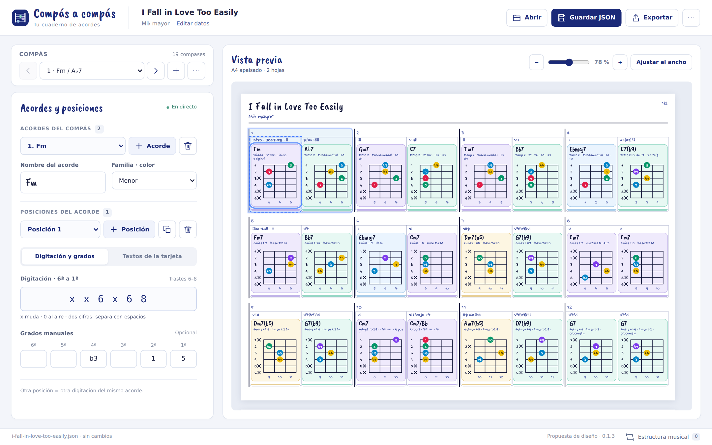
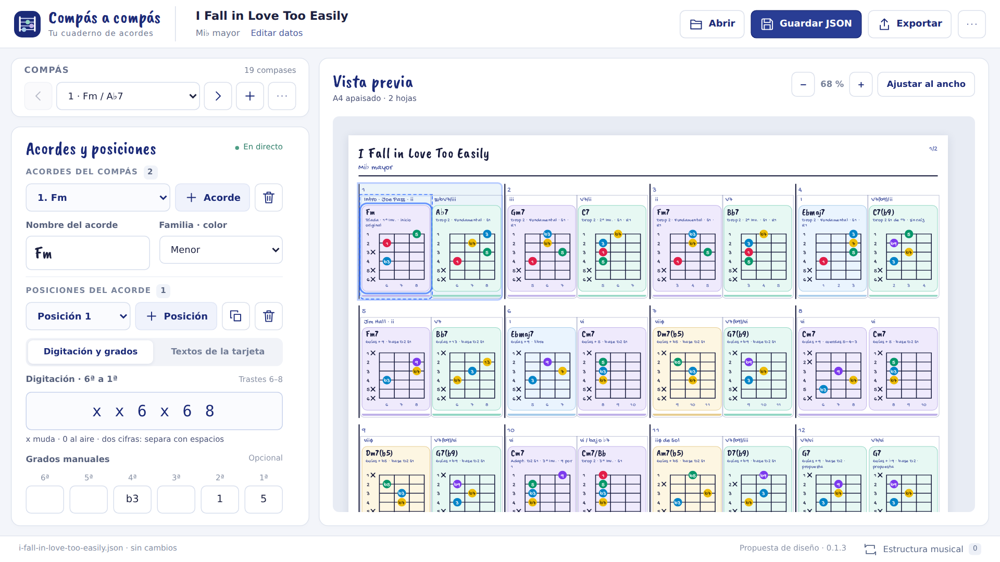

# Propuesta: editor sin scroll para las acciones habituales

Rama `design/editor-sin-scroll`, creada desde `main` en `e33d87c`. Diseño en revisión con el usuario, sin fusionar ni publicar una versión nueva.

## Distribución

- Dos columnas: edición compacta a la izquierda y vista previa más ancha a la derecha.
- Selector de compás con anterior, siguiente y añadir. Etiqueta, insertar, duplicar, mover, borrar e importar lista están en su menú de opciones.
- Selectores de acorde y posición, con botones separados para añadir cada uno. Duplicar y borrar posición usan iconos con nombre accesible y ayuda al pasar el cursor.
- Nombre del acorde, familia, digitación y seis grados visibles en la edición habitual. Los textos tienen su propia pestaña.
- Título, tonalidad y versión del documento se editan al pulsar el nombre de canción en la cabecera.
- Repeticiones, casillas, Segno, Coda y Fine se abren desde **Estructura musical**. El acceso muestra cuántas marcas hay y resalta las referencias pendientes.
- Abrir y Guardar JSON siguen a mano; HTML e impresión se agrupan en Exportar.

El editor no despliega una lista vertical por cada acorde o posición. Los selectores permiten llegar a cualquier elemento sin aumentar la altura del formulario. En pantallas pequeñas, los paneles se apilan; los diálogos largos, los avisos extensos y el visor de varias hojas conservan desplazamiento cuando hace falta.

## Capturas reales

Chromium 153 en Linux, escala de dispositivo 1,5. Se abrió el JSON de 19 compases de «I Fall in Love Too Easily» que ya se utilizaba para revisar la aplicación. La captura no sustituye el JSON del ejemplo ni añade esa canción al programa.

### Escritorio, 1440 × 900

### Portátil, 1280 × 720

## Comprobaciones realizadas

- 126 pruebas Node superadas.
- A 1440×900, 1366×768, 1280×720, 1180×720, 1024×768 y 800×600: sin desplazamiento exterior ni desbordamiento horizontal; los seis grados quedan visibles. Comprobado también que añadir una posición vacía cabe sin scroll en 1280×720 y 800×600.
- Abrir/guardar JSON, nombre de canción, nombre de acorde, digitación válida e inválida, grados, añadir acorde y posición, duplicar, cancelar y confirmar el borrado de posición, cambiar selección y editar la etiqueta del compás.
- Textos comunes y personalizados conservados en JSON, con la pestaña seleccionada estable al cambiar la herencia. Navegación de pestañas con flechas.
- Diálogos de canción y estructura accesibles y cerrables con Escape; menús cerrables con Escape y al pulsar fuera.
- 40 posiciones de un acorde y 30 compases accesibles mediante selectores; el editor no crece con esas listas.
- A 390×844: controles accesibles con el diseño apilado y sin desbordamiento horizontal. No se promete ausencia de scroll en móvil.
- HTML exportado del ejemplo idéntico byte a byte al de `main`; modelo, esquema, geometría, renderizador de hoja y exportador sin cambios.
- Capturas de escritorio, portátil, pestaña de textos y diálogos revisadas visualmente. Sin errores JavaScript en las comprobaciones de interacción.

Pendiente: valoración del usuario, pruebas nativas en Windows y revisión en otros navegadores. Los manuales PDF existentes describen la interfaz aprobada 0.1.3; se actualizarán si se acepta esta propuesta.

## Archivos

`index.html`, `src/main.js`, `src/ui/chord.js`, `src/ui/measures.js`, `src/ui/textOverride.js`; nuevos `src/ui/icons.js`, `src/ui/workspace.js` y `styles/workspace.css`. La hoja conserva sus estilos y medidas anteriores. Esta carpeta y `docs/ESTADO.md` registran la propuesta.
