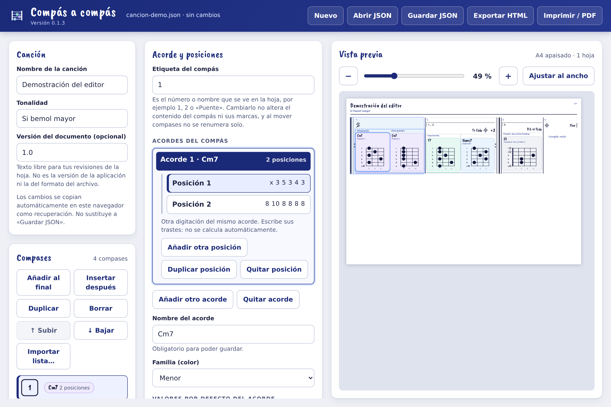
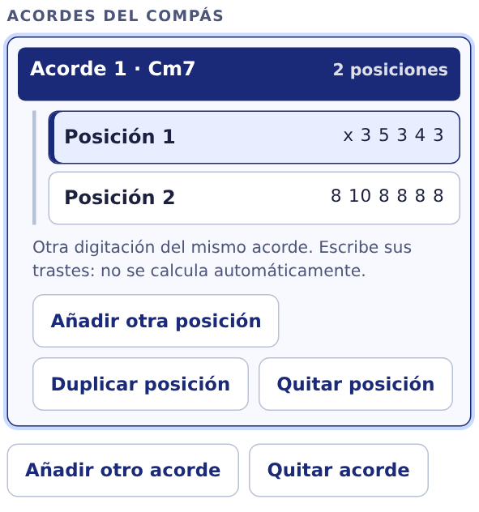

# Manual de uso — Compás a compás

Aplicación 0.1.3 · Edición del manual: 17/10/2026. Autor del proyecto: Jesús Quevedo Rodríguez.

## Preparar una canción

1. Abre `Abrir-Compas.cmd` desde la carpeta del proyecto. Conserva abierta la consola que arranca el servidor.
2. Pulsa **Nuevo** para comenzar una hoja o **Abrir JSON** para continuar una canción guardada. Para practicar puedes abrir `examples/cancion-demo.json`.
3. Escribe el **nombre de la canción** y la **tonalidad**. Aparecen en la cabecera de cada hoja. La **versión del documento** es una etiqueta opcional para tus revisiones; no cambia la versión de la aplicación.
4. Añade compases y sus posiciones. Revisa el resultado a la derecha y guarda con **Guardar JSON**.

La interfaz separa los datos de la canción, el editor y la vista previa. En ordenador, cada zona tiene su propio desplazamiento; puedes bajar por los acordes manteniendo visible la hoja. En móvil se apilan las zonas. **Ajustar al ancho** y los botones de zoom solo cambian la vista, no el tamaño de impresión.



## Compás, acorde y posición

Un **compás** contiene uno o varios **acordes**. Cada acorde puede tener varias **posiciones** o *voicings*: distintas digitaciones del mismo acorde.

| Quiero escribir… | Acción |
| --- | --- |
| Cm7 y después F7 en el mismo compás | Añadir otro acorde |
| Dos maneras de tocar Cm7 | Añadir otra posición dentro de Cm7 |
| La misma posición con un pequeño cambio | Duplicar posición y editar sus trastes |

Añadir una posición no crea otro acorde ni asigna tiempos. La aplicación tampoco calcula cuánto dura cada acorde.

Selecciona un compás en la lista o pulsa una tarjeta de la hoja para editarla. Puedes insertar, duplicar, mover o borrar compases. Su etiqueta visible se puede escribir y **no se renumera automáticamente** al moverlos. Antes de borrar un compás se muestran las consecuencias para sus marcas musicales.

## Escribir digitaciones, grados y textos

### Digitación

Introduce **seis valores, de sexta a primera cuerda**: la cuerda grave primero y la aguda al final. Usa `x` para una cuerda muda y `0` para una cuerda al aire.

```text
x 3 5 3 4 3       Cm7
x 10 12 10 11 10  Una posición en trastes de dos cifras
0 2 2 4 0 0       Ejemplo que ocupa cuatro trastes
```

También se acepta `x35343` cuando cada traste tiene una cifra. Usa espacios si hay trastes de dos cifras. Una entrada incorrecta muestra un aviso y conserva la última digitación válida.

Una posición nueva empieza con todas las cuerdas mudas: debes introducir sus notas. En el dibujo, la primera cuerda está arriba. El mástil muestra al menos tres trastes y **crece solo** a cuatro o más si lo necesita. El límite actual es un intervalo visible de 32 trastes; si se supera, conserva los datos, avisa y bloquea la exportación hasta corregirlo.

### Grados y color

Los seis campos de grados siguen el mismo orden, de sexta a primera cuerda. Son opcionales y manuales: puedes escribir `1`, `b3`, `5` o `b7`, por ejemplo. Los grados reconocidos colorean los puntos; un campo vacío deja la nota sin grado. Los textos largos se abrevian en el punto y se explican en una leyenda.

El selector de familia cambia la presentación del acorde. No analiza sus notas ni genera una digitación.

### Texto encima y dentro

Escribe los textos comunes en el acorde. Para cada posición puedes **heredarlos**, **personalizarlos** u **ocultarlos**. Así puedes mantener un título compartido y poner una indicación distinta en cada tarjeta.



## Añadir varios compases mediante una lista

Abre **Importar lista** e introduce una línea por compás:

```text
1 | Cm7 @ x 3 5 3 4 3 / 8 10 8 8 8 8
2 | F7 @ 1 3 1 2 1 1 ; Bbmaj7 @ x 1 3 2 3 1
3 |
```

- `|` separa la etiqueta y el contenido del compás.
- `@` separa el nombre del acorde y su digitación.
- `;` añade otro acorde al mismo compás.
- ` / `, con espacios, añade otra posición al acorde. `C/E` sigue siendo un nombre de acorde.
- Una línea como `3 |` crea un compás vacío.

Comprueba la previsualización. La lista se **añade al final** de la canción y solo se importa si no hay errores. No sustituye los compases existentes.

## Repeticiones, casillas y saltos

El panel **Marcas musicales** permite añadir y editar la estructura escrita:

| Marca | Cómo prepararla |
| --- | --- |
| Repetición | Elige el compás inicial, el final y el número total de pasadas. ×3 significa tres pasadas en total. |
| Casilla | Elige su inicio y final, las pasadas y, cuando corresponda, la repetición a la que pertenece. |
| Segno, Coda y Fine | Coloca la marca antes o después del compás elegido. |
| D.C., D.S. y variantes | Elige el salto y los destinos Segno, Coda o Fine que solicite el formulario. |
| To Coda | Colócalo en el punto de salida y selecciona la Coda de destino. |

Para una indicación **D.S. al Coda**, crea primero el Segno y la Coda; después configura el salto y el To Coda correspondiente. Revisa el recorrido escrito como lo harías en una partitura.

Las marcas se dibujan, pero **no hay reproducción ni comprobación del recorrido musical completo**. Si falta un destino, aparece un aviso y la referencia queda pendiente; no salta a otro compás por su cuenta. Corrige el destino desde el panel. Antes de exportar referencias pendientes se pide confirmación.

## Guardar y recuperar el trabajo

**Guardar JSON** conserva la canción editable completa. Según el navegador, aparecerá un selector de archivo o una descarga. Elige una carpeta conocida y conserva copias con nombres como `Mi-cancion-01.json`.

**Abrir JSON** permite continuar ese proyecto. Si el formato es inválido, tiene campos desconocidos o pertenece a otra versión de esquema, se rechaza y la canción abierta se conserva. Nuevo y Abrir avisan si tienes cambios pendientes.

El navegador guarda además una recuperación local y la ofrece al volver a entrar si quedaron cambios pendientes. Depende del mismo navegador, perfil y dirección de la aplicación; otro puerto usa otro almacenamiento. Se borra al guardar, abrir o crear una canción. **La recuperación no sustituye al archivo JSON.**

Exportar HTML o imprimir no equivale a guardar los cambios del proyecto. Guarda el JSON antes de cerrar. La aplicación no tiene deshacer.

## Exportar e imprimir

**Exportar HTML** crea un archivo único con las hojas, estilos y fuentes incluidos. Puedes abrirlo sin conexión y compartirlo. No contiene el editor ni sirve para recuperar una canción editable.

**Imprimir / PDF** abre la impresión del navegador con las mismas hojas. Para guardar como PDF:

1. Selecciona **Guardar como PDF** como destino.
2. Elige papel **A4 horizontal**, escala **100 %** y márgenes **Ninguno**.
3. Desactiva los encabezados y pies del navegador. Activa los gráficos de fondo si los colores no aparecen.
4. Revisa la previsualización y guarda el archivo.

Cada página lleva nombre de canción, tonalidad y numeración `actual/total` arriba a la derecha. La hoja mide 297 × 210 mm y ya incluye sus márgenes de 5 mm.

Las filas se adaptan al contenido: no hay cuatro compases fijos por fila. Al añadir compases se vuelve a repartir la canción. Las tarjetas pueden ensancharse para completar una fila, mientras el dibujo conserva la escala de sus trastes. Un compás muy largo continúa entre tarjetas en otra fila u hoja, con su etiqueta y la indicación de continuación.

Si una digitación o un bloque no cabe, se avisa y se bloquea la salida; nunca se modifican tus trastes para hacerlos caber.

## Si algo no sale como esperabas

| Situación | Qué revisar |
| --- | --- |
| He añadido una posición y parece vacía | Empieza con seis cuerdas mudas. Escribe una digitación distinta para verla. |
| Dos posiciones muestran el mismo texto | Comprueba si heredan el texto del acorde; personaliza una de ellas. |
| La siguiente hoja tiene tarjetas más anchas | Las filas parciales reparten el ancho disponible. El zoom no cambia el tamaño exportado. |
| El grado no aparece | Comprueba el orden de las cuerdas y si esa cuerda está muda. |
| Hay un destino pendiente | Vuelve a elegir la marca o el compás en Marcas musicales. |
| El navegador no abre la aplicación | Consulta el manual de instalación; el editor necesita el servidor local. |

La versión 0.1.3 se ha comprobado en Chromium. Firefox, Safari y el diálogo de impresión nativo de Windows siguen pendientes de comprobación.
