# Manual de uso — Compás a compás

Aplicación 0.8.1 · Edición del manual: 27/10/2026. Autor del proyecto: Jesús Quevedo Rodríguez.

## Preparar una canción

El botón **Manual** (icono de libro) de la barra superior abre una página de ayuda en otra pestaña, con un resumen y un enlace a este manual en PDF. Funciona igual en local que en GitHub Pages. Solo existe en la aplicación: no aparece en los HTML ni en los PDF de canciones que exportes.

1. Abre la aplicación en [GitHub Pages](https://a01653.github.io/Compas-a-compas/) o con `Abrir-Compas.cmd` desde la carpeta del proyecto. En local, conserva abierta la consola que arranca el servidor.
2. Abre el menú superior de tres puntos y pulsa **Nueva canción**, o pulsa **Abrir** para continuar una canción guardada. Para practicar puedes abrir `examples/cancion-demo.json`.
3. Pulsa el título de la cabecera para abrir los datos y escribe el **nombre de la canción** y la **tonalidad**. La tonalidad aparece a continuación del nombre en cada hoja. Puedes elegir su calidad para el color inicial de las franjas de las tarjetas. La **versión del documento** es una etiqueta opcional para tus revisiones; no cambia la versión de la aplicación.
4. Añade compases y sus posiciones. Revisa el resultado a la derecha y guarda con **Guardar JSON**.

La interfaz tiene un editor compacto a la izquierda y la hoja a la derecha. Los selectores de compás y tarjeta evitan listas verticales largas. Digitación y grados quedan en la parte alta del editor; los textos y la tonalidad de la tarjeta aparecen debajo. El editor conserva desplazamiento interno cuando no cabe todo. En móvil se apilan las zonas. **Ajustar al ancho** y los botones de zoom solo cambian la vista, no el tamaño de impresión.


## Tarjetas del compás

Cada dibujo es una **tarjeta**. Tiene su nombre de acorde, calidad/color, digitación, grados, título exterior, anotación y tonalidad. Para escribir dos digitaciones del mismo acorde, añade dos tarjetas con ese nombre. Para escribir dos acordes distintos, cambia el nombre de cada una. Se manejan igual.

Usa el único selector **Tarjetas del compás** para elegir una tarjeta, o púlsala directamente en la hoja. **Añadir tarjeta** crea una tarjeta lista para introducir sus notas y sin nombre: la hoja no dibuja nada hasta que lo escribas (el editor muestra «Sin nombre» solo como ayuda). **Duplicar tarjeta** copia la seleccionada a continuación. Al editar un campo no cambian las otras tarjetas, aunque compartan el mismo nombre.

Los archivos anteriores siguen abriendo. Si contenían varias posiciones agrupadas bajo un acorde, ahora aparecen como tarjetas separadas en el selector. Abrir y guardar sin editar conserva el archivo; el cambio de interfaz no elimina datos ni crea notas.

Selecciona un compás en el desplegable superior o con las flechas. El botón + añade un compás al final. Para insertar, copiar, mover o borrar compases, consulta [Organizar compases](#organizar-compases).

### Copiar, pegar y ordenar tarjetas

El botón de tres puntos al final de la fila de tarjetas abre **Opciones de la tarjeta**. Las mismas opciones aparecen al pulsar una tarjeta de la hoja con el botón derecho. Se aplican a la tarjeta seleccionada o, si has marcado varias (ver [Seleccionar tarjetas o compases](#seleccionar-tarjetas-o-compases)), a todas ellas:

- **Copiar tarjeta** guarda la tarjeta con su nombre, calidad, textos, grado, tonalidad y digitación. **Cortar tarjeta** la copia y la quita. Puedes pegarla en otro compás, o en otra canción que abras después, mientras no recargues la página.
- **Pegar tarjeta antes** y **Pegar tarjeta después** añaden tarjetas independientes con lo copiado junto a la seleccionada, en el orden en que estaban. En un compás de repetición, primero se quita la repetición y se avisa.
- **Sustituir tarjeta por la copiada** cambia la tarjeta entera por la copiada: nombre, calidad, textos, grado, tonalidad y digitación. La tarjeta conserva su sitio en el compás.
- **Sustituir digitación por la copiada** cambia solo la digitación: trastes, grados por cuerda y traste de referencia. El nombre, la calidad, los textos, el grado de la tarjeta y su tonalidad no cambian. Sirve para probar otro voicing del mismo acorde sin reescribir sus textos.
- **Mover tarjeta antes** y **Mover tarjeta después** cambian el orden de las tarjetas dentro del compás (una tarjeta cada vez). Si el archivo agrupaba varias posiciones bajo un mismo acorde, se reordenan dentro de él.
- **Añadir tarjeta a la selección** marca la tarjeta sin usar el ratón.
- **Quitar tarjeta** borra solamente la tarjeta o tarjetas seleccionadas, tras confirmar.

Para sustituir, una tarjeta copiada sirve para todas las seleccionadas; si copiaste varias, selecciona otras tantas y se aplican en orden. Cada acción es un solo paso de **Deshacer**, y el aviso posterior incluye **Deshacer**.

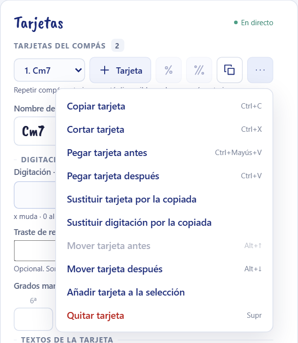

Ejemplo: para usar en el compás 6 la digitación `x 3 5 3 4 3` que ya escribiste en el compás 2 sin perder el título «Puente» del compás 6, selecciona la tarjeta del compás 2, pulsa **Copiar tarjeta**, selecciona la tarjeta del compás 6 y pulsa **Sustituir digitación por la copiada**. Si quieres además su nombre y sus textos, usa **Sustituir tarjeta por la copiada**.

### Repetir uno o dos compases

Junto a **Añadir tarjeta** hay dos botones con el signo de repetición. No crean compases nuevos por sí solos ni copian tarjetas: la hoja dibuja un signo grande y el contenido se lee en el origen.

- **Repetir compás anterior** (signo de porcentaje musical): el compás seleccionado repite el compás inmediatamente anterior. Está desactivado en el primer compás. Si el compás tiene tarjetas, pide confirmar antes de sustituirlas; cancelar no cambia nada y aceptar se deshace de una vez. Se permiten varios compases de repetición seguidos.
- **Repetir dos compases anteriores** (dos barras oblicuas): el compás seleccionado y el siguiente forman la pareja de destino y repiten, en orden, los dos compases escritos antes. El signo se dibuja sobre la barra de compás común y los dos destinos van siempre en la misma línea. Necesita dos compases antes del seleccionado y uno después: si falta el segundo destino, la aplicación pregunta antes de añadir un compás vacío al final.

En un compás de repetición, el editor muestra un aviso con **Quitar repetición** (en la pareja quita las dos a la vez y deja ambos compases vacíos y editables). Si pulsas **Añadir tarjeta** en uno de ellos, se sale de la repetición y se avisa. Números, Coda, Fine, casillas y barras de repetición del compás se conservan.

Si borras o mueves un compás de origen o de destino, la referencia se conserva y se avisa en el editor del compás y al mover; no se redirige sola. **Corregir referencia** la apunta de nuevo a los compases inmediatamente anteriores. Duplicar o pegar un compás de repetición hace que la copia repita el compás que queda delante de ella; duplicar un solo destino de una pareja crea un compás vacío, que se coloca después de la pareja para no separarla.

Los archivos con estos campos (`repeatPrevious`, `repeatPreviousTwo`) requieren 0.7.0 o posterior.

## Organizar compases

Las acciones de compás están en dos sitios con el mismo contenido: el menú de tres puntos del bloque **Compás** y el **menú contextual** que aparece al pulsar con el botón derecho un compás de la hoja fuera de sus tarjetas (en su número, su título o un hueco). Se aplican al compás activo o, si has seleccionado varios, a todos ellos en el orden de la canción. Cada acción es un solo paso de **Deshacer**. Si has copiado tarjetas, el menú contextual del compás ofrece además **Pegar tarjeta al final del compás**, que sirve también para un compás vacío.

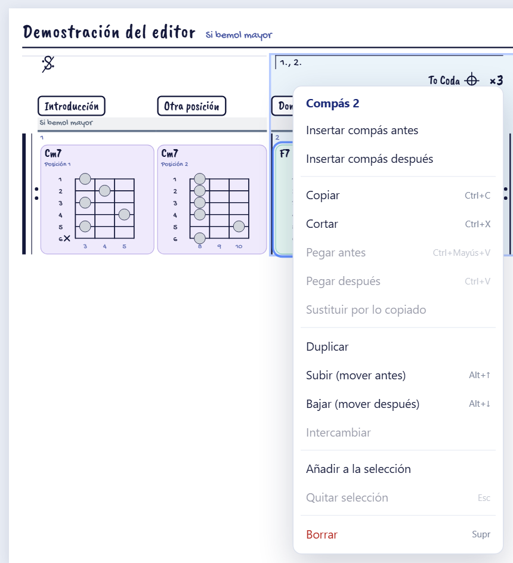

Con la hoja enfocada, la tecla de menú del teclado o **Mayús+F10** abren el menú de lo seleccionado: el de la tarjeta o el del compás. En pantallas táctiles usa los menús de tres puntos del bloque Compás y de la fila de tarjetas.

### Seleccionar tarjetas o compases

En la hoja, lo que pulsas decide qué seleccionas: **dentro del recuadro de una tarjeta**, esa tarjeta; **en el resto del compás** (su número, su título, la franja de tonalidad o un hueco), el compás entero. Lo señalado se resalta más: con una tarjeta pulsada, el compás queda en segundo plano, y al revés. Copiar, cortar, mover y borrar, con sus atajos, actúan sobre lo señalado.

Hay tres formas de marcar varias tarjetas o varios compases:

1. **Ctrl+clic** (Cmd+clic en Mac) añade o quita una tarjeta o un compás de la selección. Si no había nada marcado, se incluye también lo último que pulsaste, si era del mismo tipo. Así puedes marcar tarjetas salteadas, por ejemplo la primera y la tercera de un compás de tres.
2. **Mayús+clic** marca el tramo entre lo activo y lo pulsado: todas las tarjetas intermedias, en orden, o todos los compases intermedios.
3. Con **Modo selección** (menú del compás), cada clic o toque en la hoja marca o desmarca la tarjeta o el compás pulsado. Las casillas de la esquina de cada compás muestran su estado. Sin ratón, usa **Añadir a la selección** del menú del compás o **Añadir tarjeta a la selección** del menú de la tarjeta.

Una selección tiene tarjetas o compases, nunca las dos cosas: si tienes tarjetas marcadas y haces Ctrl+clic en un compás, las tarjetas se desmarcan y se marca el compás, y al revés. Los compases marcados se ven con fondo ámbar y borde discontinuo, y llevan ✓ en el desplegable; las tarjetas marcadas, con un anillo ámbar. Bajo el selector de compás aparece cuántos hay, con **Terminar** (sale del modo selección y conserva la marca) y **Quitar selección**. Un clic normal en la hoja, **Quitar selección** o **Esc** vuelven a una sola tarjeta o compás. La selección no se guarda en el archivo.

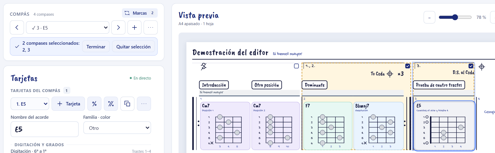

Ejemplo: para llevar al compás 4 la primera y la tercera tarjeta del compás 2, pulsa la primera, haz Ctrl+clic en la tercera y pulsa **Ctrl+C**. Después pulsa el compás 4 fuera de sus tarjetas (o en su hueco, si está vacío) y pulsa **Ctrl+V**: las dos tarjetas se añaden al final del compás 4, en su orden. Si en vez del compás pulsas una de sus tarjetas, se pegan después de ella.

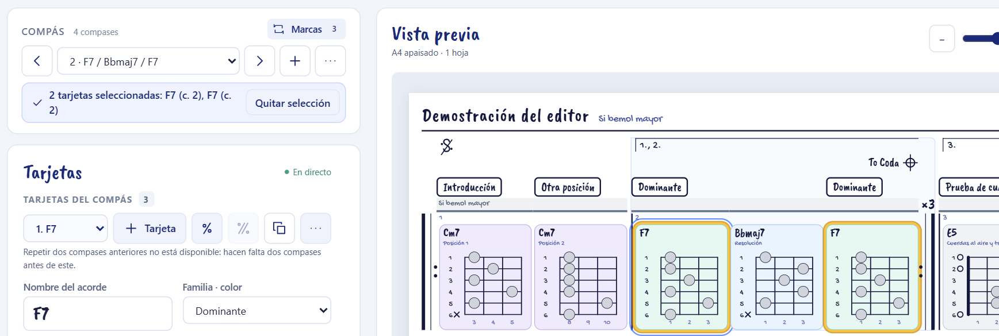

### Insertar, mover e intercambiar

- **Insertar compás antes** e **Insertar compás después** añaden un compás vacío junto a la selección.
- **Subir (mover antes)** y **Bajar (mover después)** desplazan una posición los compases seleccionados, aunque no sean contiguos, y conservan su orden. Atajos: **Alt+↑** y **Alt+↓**.
- **Intercambiar** cambia de sitio los dos compases seleccionados, con todo su contenido.

Los dos compases de una repetición de dos compases se mueven siempre juntos, y lo que insertes o pegues junto a uno de ellos se coloca fuera de la pareja. Las marcas musicales (repeticiones, casillas, Segno, Coda, Fine y saltos) viajan con su compás.

### Copiar, cortar, pegar y duplicar

1. Selecciona uno o varios compases.
2. Pulsa **Copiar** (**Ctrl+C**) o **Cortar** (**Ctrl+X**). Cortar quita los compases y, si tienen marcas, avisa antes.
3. Selecciona el compás de destino y pulsa **Pegar después** (**Ctrl+V**) o **Pegar antes** (**Ctrl+Mayús+V**).

Las copias conservan acordes, digitaciones, grados, textos, tonalidades y ancho del compás, con identificadores nuevos, de modo que nunca se repiten. **Duplicar** hace lo mismo en un paso y coloca la copia justo después del bloque. Lo copiado se puede pegar varias veces, y también en otra canción que abras después, mientras no recargues la página. Las copias no heredan **Ajustar línea al ancho**, que pertenece a la línea del original.

Al pegar lo cortado en la misma canción, los compases recuperan sus identificadores: sus marcas vuelven a encontrarlos, como si los hubieras movido. Pegarlo una segunda vez crea copias.

### Sustituir un compás por otro

1. Copia el compás cuyo contenido quieres usar.
2. Selecciona el compás que vas a cambiar y pulsa **Sustituir por lo copiado**. Confirma el aviso.

Se cambian todas sus tarjetas, voicings, textos, tonalidades y su ancho; se conservan su etiqueta, su identificador y sus marcas. Un compás copiado puede sustituir a varios seleccionados a la vez; varios compases copiados sustituyen a otros tantos, en orden. Si el compás formaba parte de una repetición de dos compases, la pareja se quita y se avisa.

### Borrar y deshacer

**Borrar** (**Supr**) pide siempre confirmación y enumera las marcas que dependen de los compases: se conservan con la referencia pendiente y nunca se redirigen a otro compás. El aviso posterior incluye **Deshacer** para recuperar lo borrado al momento; también sirven la flecha de la cabecera y **Ctrl+Z**.

### Numeración de los compases

Con **Renumerar etiquetas automáticamente** marcado (opción por defecto, en el menú del compás), insertar, pegar, duplicar, mover, intercambiar o borrar vuelve a numerar en orden las etiquetas numéricas, empezando por el número del primer compás numerado: una canción que empieza en el compás 0 o en el 17 lo conserva. El aviso indica cuántas etiquetas han cambiado. Las etiquetas no numéricas, como «Intro» o «12a», se conservan y no consumen número.

Desmárcalo para mantener los números originales de una partitura transcrita: los compases conservan su etiqueta al moverlos, los nuevos reciben el número siguiente al mayor y las copias se marcan «(copia)». La elección se guarda con la canción (`renumberMeasures`) y se puede deshacer. **Renumerar ahora** aplica la numeración en ese momento.

### Repeticiones al reorganizar

Mover o insertar un compás entre un compás de repetición y su origen deja la referencia apuntando al origen anterior. La aplicación no la cambia por su cuenta: el aviso lo explica y ofrece **Corregir referencias**, que apunta la repetición a los compases que ahora tiene delante.

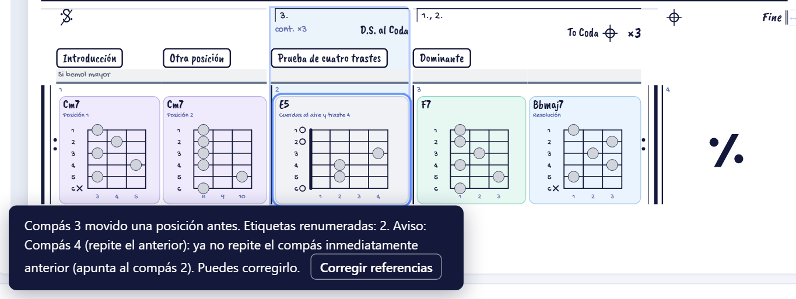

### Atajos de teclado

Funcionan fuera de los campos de texto y sin diálogos abiertos, sobre lo señalado en la hoja: las tarjetas o los compases seleccionados. Si has seleccionado texto en la página, Ctrl+C y Ctrl+X lo copian como siempre. Los menús muestran cada atajo junto a la opción a la que corresponde en ese momento.

| Atajo | Acción |
| --- | --- |
| Ctrl+C / Ctrl+X | Copiar / cortar las tarjetas o los compases seleccionados |
| Ctrl+V / Ctrl+Mayús+V | Pegar lo último copiado después / antes de la selección. Las tarjetas copiadas sobre un compás señalado van al final / al principio de ese compás |
| Alt+↑ / Alt+↓ | Mover la tarjeta o los compases seleccionados una posición antes / después |
| Supr | Borrar las tarjetas o los compases seleccionados, con confirmación |
| Ctrl+Z / Ctrl+Y | Deshacer / rehacer |
| Esc | Quitar la selección de varias tarjetas o compases |
| Mayús+F10 | Menú contextual de lo seleccionado, con la hoja enfocada |

## Escribir digitaciones, grados y textos

### Digitación

Introduce **seis valores, de sexta a primera cuerda**: la cuerda grave primero y la aguda al final. Usa `x` para una cuerda muda y `0` para una cuerda al aire.

```text
x 3 5 3 4 3       Cm7
x 10 12 10 11 10  Una posición en trastes de dos cifras
xa9axa            G7: lo mismo que x 10 9 10 x 10, con letras
0 2 2 4 0 0       Ejemplo que ocupa cuatro trastes
```

También se acepta `x35343` cuando cada traste tiene una cifra. Para los trastes de dos cifras, sepáralos con espacios o escribe cada uno con una letra: `a` = 10, `b` = 11, `c` = 12… hasta `o` = 24. Así puedes pegar `xa9axa` tal cual; al volver a la tarjeta, el campo lo muestra como `x 10 9 10 x 10`. Una entrada incorrecta muestra un aviso y conserva la última digitación válida.

Una tarjeta nueva empieza con todas las cuerdas mudas: debes introducir sus notas. En el dibujo, la primera cuerda está arriba. El mástil muestra al menos tres trastes y **crece solo** a cuatro o más si lo necesita. El límite actual es un intervalo visible de 32 trastes; si se supera, conserva los datos, avisa y bloquea la exportación hasta corregirlo.

En los datos de cada posición puedes indicar **Traste de referencia resaltado**. La aplicación sombrea esa columna del mástil y amplía el dibujo para incluirla aunque no haya una nota en ese traste. Déjalo vacío si no quieres una referencia. Este campo permite reproducir las franjas oscuras que algunas láminas usan para señalar la zona del diapasón.

### Grados y color

Los seis campos de grados siguen el mismo orden, de sexta a primera cuerda. Son opcionales y manuales: puedes escribir `1`, `b3`, `5` o `b7`, por ejemplo. Los grados reconocidos colorean los puntos; un campo vacío deja la nota sin grado. Los textos largos se abrevian en el punto y se explican en una leyenda.

El selector de calidad cambia el fondo de la tarjeta. No analiza sus notas ni genera una digitación.

### Elegir los colores

Pulsa **Colores** en la cabecera. En **Calidad del acorde** cambia el fondo de mayor, menor, dominante, semidisminuido, disminuido y otros. Se usa la familia que hayas elegido en cada acorde; no se deduce del nombre.

En **Notas y grados**, elige naturales, bemoles o sostenidos para ver los grados del 1 al 13. Cada uno tiene su propio color: cambiar `b3` no modifica `3`. Puedes usar el selector de color o escribir un hexadecimal `#RRGGBB`. **Otro grado o etiqueta** añade valores como `bb7`, `##4` o `R`, de hasta 32 caracteres. Los símbolos ♭ y ♯ equivalen a `b` y `#`. Cada grado tiene un **Fondo** y un **Texto** independientes (selector y hexadecimal, cada uno con su flecha de restaurar); el texto es blanco por defecto y nunca se cambia solo. La muestra enseña la combinación real. También se pueden cambiar el fondo y el texto de las notas sin grado o sin un color propio; su fondo de serie es un gris claro (`#d1d5db`).

Las muestras se actualizan y los colores se aplican a todos los compases de esta canción. En las tarjetas, el texto y la rejilla se adaptan para leer sobre fondos oscuros; en los puntos de grado manda el texto que elijas. La flecha circular restaura un color; **Restaurar paleta original** pide confirmar antes de quitar todos los colores personalizados.

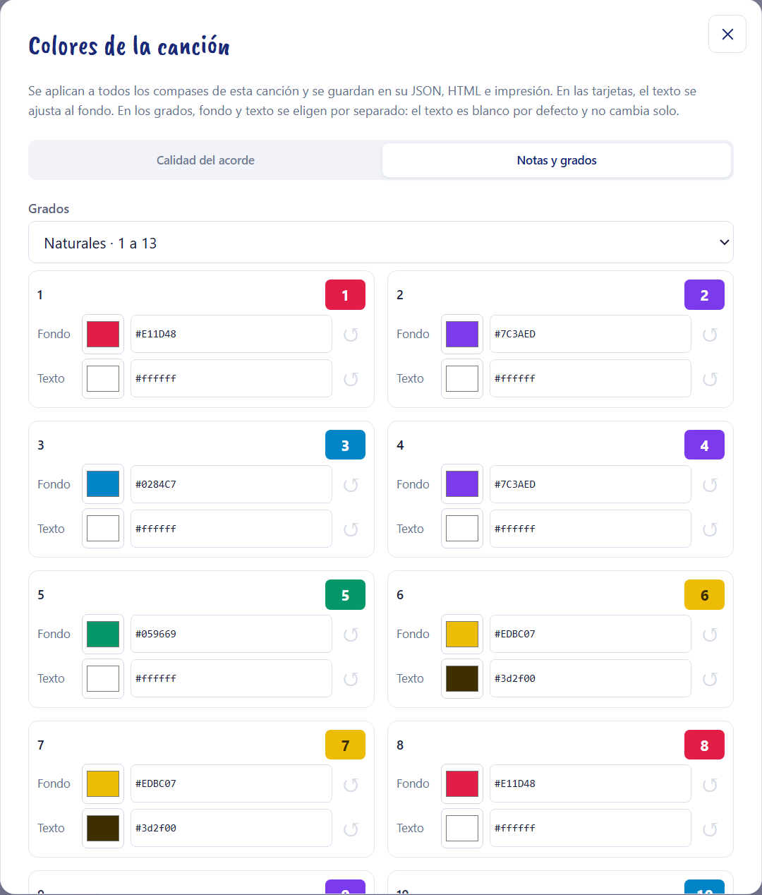

Pulsa **Listo** para cerrar y **Guardar JSON** para conservar la paleta en el archivo. Se incluye también en HTML e impresión. Abrir otra canción utiliza sus colores, o los predeterminados (`config/palette-defaults.json`) si no tiene una paleta guardada; esos valores nunca se escriben en tu archivo. Las versiones anteriores a 0.3.0 no pueden abrir JSON con el campo `palette`; utiliza la aplicación actualizada.

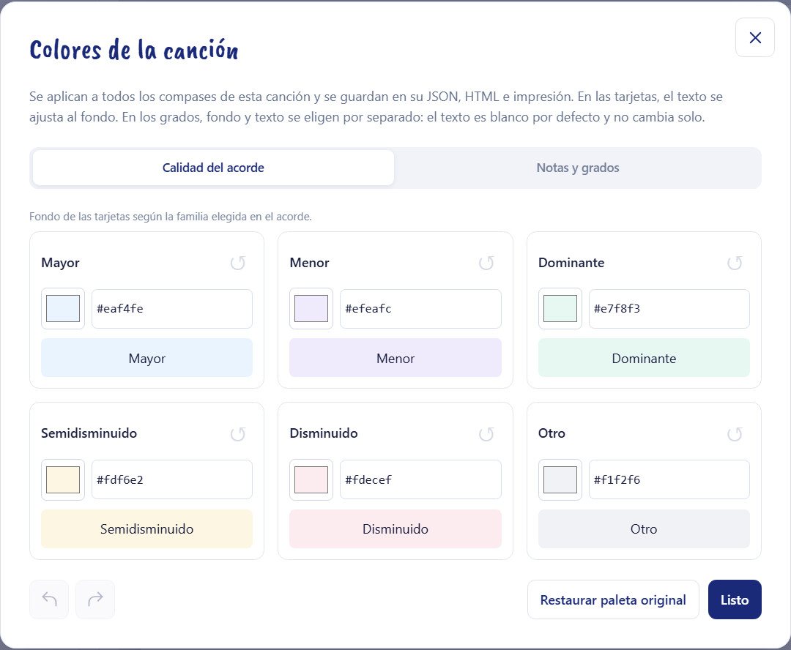

### Títulos, anotaciones y grado de la tarjeta

El bloque **Textos de la tarjeta** aparece debajo de digitación y grados, siempre visible y sin pestañas. **Título sobre compás** se dibuja en un recuadro encima del compás, fuera de su línea vertical, empezando en la tarjeta donde lo escribes, y puede ocupar el ancho del resto del compás: en un compás con dos tarjetas, un título como «B Final · combinación libre» se extiende sobre la segunda y queda en una sola línea. Si otra tarjeta del compás tiene su propio título, el primero termina donde empieza ese. Solo pasa a dos líneas cuando no cabe en el compás. **Anotación dentro** conserva su lugar bajo el nombre del acorde. Vaciar cualquiera lo quita de esa tarjeta.

Cada campo modifica solo la tarjeta seleccionada. No hay un selector para aplicar los textos a otras tarjetas.

**Grado de la tarjeta** es un campo manual independiente: escribe `ii`, `V7/ii` o el texto que necesites. Sale arriba a la derecha de la tarjeta, junto al acorde. No modifica los seis grados de las cuerdas ni se calcula automáticamente. Este campo pertenece siempre a la posición seleccionada.

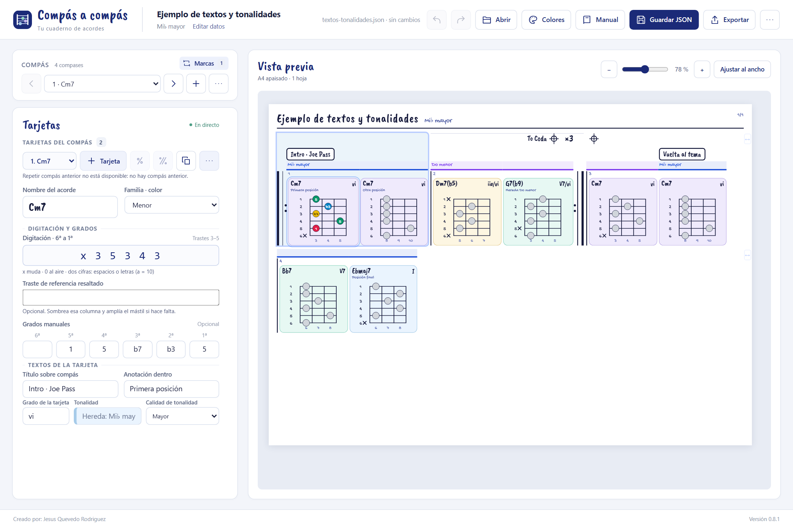

### Tonalidad de cada tarjeta

En **Tonalidad** escribe un cambio de contexto y elige su **Calidad de tonalidad**. Mayor, menor y las demás calidades usan los colores de la paleta de familias de esta canción. La calidad de la franja es independiente de la del acorde: un dominante puede llevar una tonalidad menor encima. La banda es rectangular, con fondo tenue y línea de color debajo, como en la plantilla; no lleva recuadro redondeado.

Deja el campo vacío para continuar con la tonalidad anterior, incluido su color, sin imprimir otra etiqueta. La herencia sigue el orden escrito a través de acordes, compases y páginas. No interpreta las repeticiones. Borrar un cambio hace que esa posición y las siguientes vuelvan a heredar del contexto anterior, hasta el próximo cambio escrito.

La tonalidad general inicia el contexto; si no has elegido su calidad, usa el color neutro de **Otro**. Sin tonalidad general ni cambio previo no se inventa ninguna. Cuando está vacío, el campo muestra una guía «Hereda: …» y el color del contexto efectivo; al pasar el ratón se ve la explicación completa. Elegir una calidad con el campo vacío prepara el siguiente texto; no crea un cambio invisible en el archivo.

Para ocultar las franjas en todas las hojas, abre los datos de canción pulsando su título y desmarca **Mostrar tonalidades de las tarjetas**. La tonalidad junto al título sigue visible. Mientras estén ocultas, los campos **Tonalidad** y **Calidad de tonalidad** de cada tarjeta también desaparecen del editor, porque no tendrían efecto en la hoja; sus valores se conservan y reaparecen al volver a marcar la casilla. No se borra ningún dato.

Grado y tonalidad pertenecen a la tarjeta seleccionada, igual que el resto de sus campos. Se guardan en JSON y se conservan en vista previa, HTML e impresión. Puedes probarlo abriendo `examples/textos-tonalidades.json`. Los archivos con estos campos nuevos requieren 0.5.0 o posterior; los anteriores siguen abriendo.

### Deshacer y rehacer

Pulsa la flecha hacia la izquierda de la cabecera para **Deshacer** y la flecha hacia la derecha para **Rehacer**. También están dentro de los diálogos de datos, marcas y colores, por lo que puedes deshacer una coda sin cerrar su panel. Se deshacen las acciones aplicadas a la canción: textos, digitaciones, grados, tonalidades, su visibilidad, colores, compases (también insertar, pegar, mover, sustituir, borrar y la renumeración que provoquen), acordes, posiciones y marcas musicales. Seleccionar compases no crea pasos.

La escritura continua en un campo se agrupa hasta salir de él. Fuera de los campos funcionan **Ctrl+Z** y **Ctrl+Y** o **Ctrl+Mayús+Z**; en Mac se puede usar Cmd. Dentro de un campo se conserva el deshacer habitual del navegador, también para los borradores de marcas que todavía no se han añadido.

Guardar JSON conserva el historial de esta sesión. Abrir otra canción, crear una nueva o recuperar una copia empieza otro historial. Al recargar se conserva la canción que ofrezca la recuperación, pero no sus pasos de deshacer. Hay hasta 100 pasos, sujetos a un presupuesto de tamaño; la última acción siempre se conserva. El historial no se incluye en el JSON. Una acción nueva después de deshacer elimina la rama de rehacer.


### Opciones de página

En los datos de canción hay opciones globales que solo cambian la presentación:

- **Máximo de compases por línea**: **Automático** (por defecto) reparte según el ancho disponible, como siempre. Un número del 1 al 16 es un tope, no una obligación: pueden caber menos compases si las tarjetas son anchas o la pantalla estrecha. La pareja de una repetición de dos compases no se separa, así que con tope 1 ocupa una línea con sus dos compases.
- **Mostrar números de compás**: al desmarcarla se ocultan las etiquetas de todos los compases y las líneas verticales que los separan, en la vista previa, el HTML y la impresión, útil para una hoja de acordes que no es una partitura. Las etiquetas se conservan en el archivo. Las líneas de las tarjetas, las barras y signos de repetición, Coda, Fine, casillas, saltos y el número de página siguen visibles.
- **Tamaño de los mástiles**: reduce proporcionalmente los diagramas para que quepan más filas por página, sin cambiar trastes ni notas. El 100 % conserva el tamaño normal.

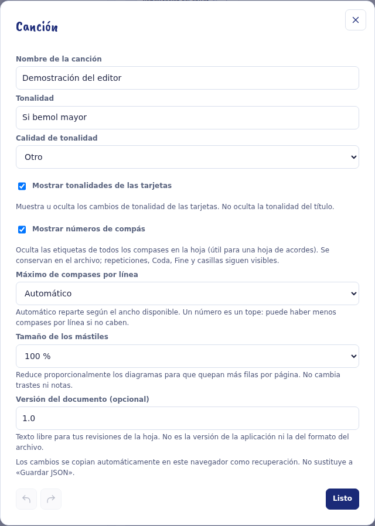

Las opciones se guardan en el JSON cuando tienen un valor distinto del predeterminado. Las versiones anteriores a la que incorpora `fretboardScalePercent` no abren archivos que incluyan ese campo.

### Ancho de cada compás y ajuste de línea

- **Ancho del compás**: en el menú de tres puntos del compás, escribe un porcentaje del 10 al 100 % del ancho de la línea. Vacío es Automático (como siempre). El ancho nunca baja de lo que necesitan las tarjetas: si el porcentaje no basta se usa el mínimo, aparece un aviso bajo la vista previa y caben menos compases en esa línea.
- **Ajustar línea al ancho**: cada línea de la vista previa tiene un botón de doble flecha horizontal en el margen derecho de la hoja. Al pulsarlo, el espacio libre se reparte entre los compases de esa línea hasta el margen derecho, sin deformar los mástiles ni comprimir ninguna tarjeta, y puede superar el 25 %. Pulsa de nuevo (queda resaltado) para volver a Automático, o usa Deshacer. Si la línea cambia de composición, el reparto se recalcula con los compases que caben.

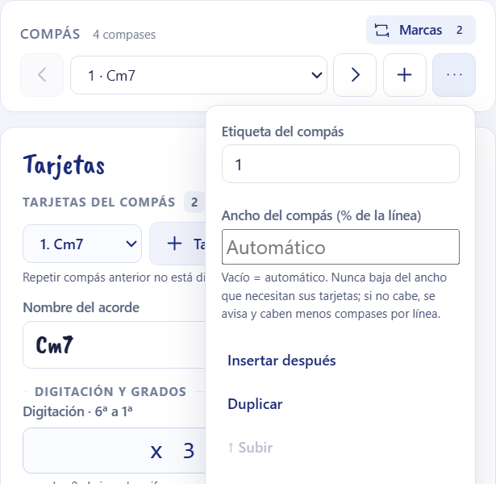

Ambos ajustes se guardan en el JSON solo cuando se usan (`widthPercent`, `fillToEdge`); las versiones anteriores a 0.7.0 no abren esos archivos.

Al ajustar al ancho varias filas de una misma página con la misma estructura, las tarjetas se alinean verticalmente. El reparto común respeta el ancho mínimo que necesita cada tarjeta; si no hay espacio suficiente para alinear sin comprimir contenido, se mantienen los anchos individuales.

Las filas ya no se estiran a todo el ancho: cada tarjeta crece como mucho un 25 % sobre su ancho natural y el sobrante queda a la derecha.

## Añadir varios compases mediante una lista

Abre el menú de tres puntos del bloque Compás y pulsa **Importar lista** e introduce una línea por compás:

```text
1 | Cm7 @ x 3 5 3 4 3 / 8 10 8 8 8 8
2 | F7 @ 1 3 1 2 1 1 ; Bbmaj7 @ x 1 3 2 3 1
3 |
```

- `|` separa la etiqueta y el contenido del compás.
- `@` separa el nombre del acorde y su digitación, escrita como en el campo **Digitación**, también con letras (`G7 @ xa9axa`).
- `;` añade otro acorde al mismo compás.
- ` / `, con espacios, añade otra posición al acorde. `C/E` sigue siendo un nombre de acorde.
- Una línea como `3 |` crea un compás vacío.

Comprueba la previsualización. La lista se **añade al final** de la canción y solo se importa si no hay errores. No sustituye los compases existentes.

## Repeticiones, casillas y saltos

Pulsa **Marcas**, junto al selector del compás. El título del panel indica **Marcas del compás 4**, por ejemplo. Muestra las marcas escritas en ese compás y las repeticiones o casillas cuyo tramo lo incluye.

Al cambiar de compás, también desde el selector del propio panel, las nuevas marcas parten del elegido. Las marcas ya guardadas conservan su ubicación. Si estabas rellenando una marca sin guardar, cambiar de compás prepara un formulario nuevo; pulsa **Añadir marca** o **Guardar cambios** antes si quieres conservar esa edición.

**Ver todas las marcas** muestra el conjunto de la canción, incluidas referencias pendientes que no puedan asociarse a un compás existente. **Ver este compás** vuelve al filtro local. Los avisos pendientes de toda la canción permanecen visibles.

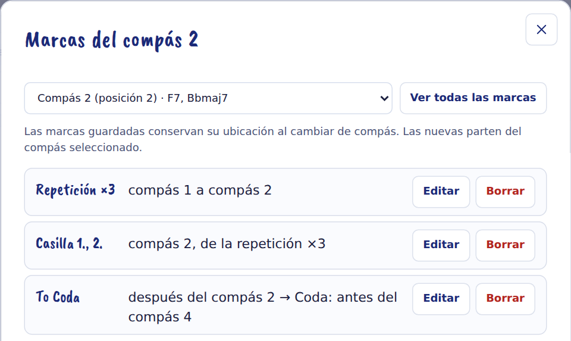

El formulario permite añadir y editar la estructura escrita:

| Marca | Cómo prepararla |
| --- | --- |
| Repetición | Elige el compás inicial, el final y el número total de pasadas. ×3 significa tres pasadas en total. |
| Casilla | Elige su inicio y final, las pasadas y, cuando corresponda, la repetición a la que pertenece. |
| Segno, Coda y Fine | Coloca la marca antes o después del compás elegido. |
| D.C., D.S. y variantes | Elige el salto y los destinos Segno, Coda o Fine que solicite el formulario. |
| To Coda | Colócalo en el punto de salida y selecciona la Coda de destino. |

Para una indicación **D.S. al Coda**, crea primero el Segno y la Coda; después configura el salto y el To Coda correspondiente. Revisa el recorrido escrito como lo harías en una partitura.

Las marcas se dibujan, pero **no hay reproducción ni comprobación del recorrido musical completo**. Si falta un destino, aparece un aviso y la referencia queda pendiente; no salta a otro compás por su cuenta. Corrige el destino desde el panel. Antes de exportar referencias pendientes se pide confirmación.

## Guardar y recuperar el trabajo

**Guardar JSON** conserva la canción editable completa. Según el navegador, aparecerá un selector de archivo o una descarga. Si abriste la canción desde un archivo, se propone el nombre de ese archivo; una canción nueva propone su título tal como lo escribiste (por ejemplo, `I Fall in Love Too Easily.json`). Elige una carpeta conocida y conserva copias con nombres como `Mi-cancion-01.json`.

**Abrir JSON** permite continuar ese proyecto. Si el formato es inválido, tiene campos desconocidos o pertenece a otra versión de esquema, se rechaza y la canción abierta se conserva. Nuevo y Abrir avisan si tienes cambios pendientes.

El navegador guarda además una recuperación local y la ofrece al volver a entrar si quedaron cambios pendientes. Depende del mismo navegador, perfil y dirección de la aplicación; otro puerto usa otro almacenamiento. Se borra al guardar, abrir o crear una canción. **La recuperación no sustituye al archivo JSON.**

Exportar HTML o imprimir no equivale a guardar los cambios del proyecto. Guarda el JSON antes de cerrar. Deshacer permite corregir acciones de esta sesión; no sustituye al archivo guardado.

## Exportar e imprimir

Abre el menú **Exportar** de la cabecera. **Exportar HTML** crea un archivo único con las hojas, estilos y fuentes incluidos. Puedes abrirlo sin conexión y compartirlo. El nombre propuesto es el título de la canción tal como lo escribiste, igual que el del PDF: `I Fall in Love Too Easily.html`. Los caracteres que Windows no admite en un nombre de archivo (`\ / : * ? " < > |`) se sustituyen por `_`. No contiene el editor ni sirve para recuperar una canción editable.

**Imprimir / PDF** abre la impresión del navegador con las mismas hojas. Para guardar como PDF:

1. Selecciona **Guardar como PDF** como destino.
2. Elige papel **A4 horizontal**, escala **100 %** y márgenes **Ninguno**.
3. Desactiva los encabezados y pies del navegador. Activa los gráficos de fondo si los colores no aparecen.
4. Revisa la previsualización y guarda el archivo. El nombre propuesto es el título de la canción (o «Hojas de acordes» si no tiene), no el de la aplicación.

Cada página lleva nombre de canción, tonalidad y numeración `actual/total` arriba a la derecha. La hoja mide 297 × 210 mm y ya incluye sus márgenes de 5 mm.

Las filas se adaptan al contenido: no hay cuatro compases fijos por fila. Al añadir compases se vuelve a repartir la canción. Las tarjetas pueden ensancharse para completar una fila, mientras el dibujo conserva la escala de sus trastes. Un compás muy largo continúa entre tarjetas en otra fila u hoja, con su etiqueta y la indicación de continuación.

Si una digitación o un bloque no cabe, se avisa y se bloquea la salida; nunca se modifican tus trastes para hacerlos caber.

## Si algo no sale como esperabas

| Situación | Qué revisar |
| --- | --- |
| He añadido una posición y parece vacía | Empieza con seis cuerdas mudas. Escribe una digitación distinta para verla. |
| Dos tarjetas muestran el mismo texto | Selecciona una y edita sus textos; solo cambia esa tarjeta. |
| La siguiente hoja tiene tarjetas más anchas | Las filas parciales reparten el ancho disponible. El zoom no cambia el tamaño exportado. |
| El grado no aparece | Comprueba el orden de las cuerdas y si esa cuerda está muda. |
| Hay un destino pendiente | Vuelve a elegir la marca o el compás en el panel Marcas. |
| Las etiquetas cambian al mover o borrar compases | Desmarca **Renumerar etiquetas automáticamente** en el menú del compás, o deshaz el último paso. |
| Pegar o Sustituir están desactivados | Copia antes uno o varios compases o tarjetas. Para sustituir, copia uno solo o tantos como selecciones. |
| Ctrl+V no pega | Sal del campo de texto donde está el cursor y cierra cualquier diálogo. Ctrl+V pega lo último que copiaste: compases o tarjetas. |
| Ctrl+C copia el compás entero en vez de una tarjeta | Pulsa dentro del recuadro de la tarjeta; el número, el título y los huecos señalan el compás. |
| Mover tarjeta está desactivado | Se mueve una sola tarjeta cada vez: quita la selección de varias. |
| Un compás de repetición avisa tras mover compases | Pulsa **Corregir referencias** en el aviso o **Corregir referencia** en el editor del compás. |
| El navegador no abre la aplicación | Abre GitHub Pages o arranca el servidor local; consulta la guía de instalación. |
